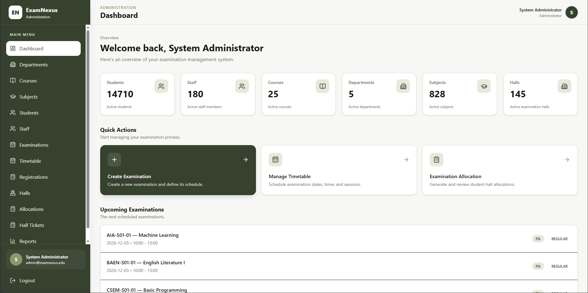

# ExamNexus — Dynamic Examination Resource Orchestration Platform

ExamNexus is a web-based examination resource orchestration platform that helps universities plan, allocate, validate, and manage examination resources.

It connects examination data, timetables, student eligibility, halls, seating, invigilators, validation, hall tickets, reporting, and controlled intelligent assistance into one workflow.

## Live Demo

- **Live Application:** [Open ExamNexus](https://examnexus-sigma.vercel.app/)
- **Source Code:** [GitHub Repository](https://github.com/mariadorthy/examnexus)
- **Demo Video:** [Watch the ExamNexus walkthrough](https://canva.link/k26mc1ce3dyutio)
- **Project Presentation:** [View the project PPT](https://drive.google.com/file/d/100PCpF2ooyal4NWUWiB1sFPA8FjD-0m7/view?usp=sharing)

> The live demo may depend on deployment availability and configured demo data. Use the recorded walkthrough if the live application is temporarily unavailable.

## Application Walkthrough

The demo demonstrates the examination management workflow, including examination setup, resource allocation, validation, administrator review, hall-ticket generation, QR verification, and intelligent what-if planning.

[**▶ Watch the full ExamNexus demo video**](https://canva.link/k26mc1ce3dyutio)

## Application Screenshots

Selected screenshots are included below to illustrate the main application workflows.

### Admin Dashboard



### Examination Resource Allocation


### Hall Ticket Verification


For additional screenshots and supporting evidence, see [`docs/screenshots/`](docs/screenshots/).

## Project Documentation

- [Project Overview](docs/project-overview.md)
- [System Architecture](docs/system-architecture.md)
- [Features and Workflows](docs/features-and-workflows.md)
- [AI and Intelligent Orchestration](docs/ai-and-intelligent-orchestration.md)
- [Development Setup](docs/development-setup.md)
- [Testing and Verification](docs/testing-and-verification.md)
- [Documentation Index](docs/README.md)

## Project Vision

ExamNexus supports the complete examination planning lifecycle:

```text
Login
  ↓
Master Data
  ↓
Examination + Timetable
  ↓
Registration + Eligibility
  ↓
Hall Allocation
  ↓
Seat + Invigilator Allocation
  ↓
Validation
  ↓
Review + Approval
  ↓
Publication + Hall Tickets
  ↓
Reports
```

The platform also supports adaptive planning when examination resources change.

```text
Existing Allocation
       ↓
Resource / Constraint Change
       ↓
What-If Reallocation
       ↓
Validation
       ↓
Administrator Approval
       ↓
Apply Changes
```

## User Roles

### Administrator

Manages examination data, timetables, registrations, allocations, validation, approval, hall tickets, reports, and reallocation.

### Staff / Invigilator

Views assigned examinations, halls, duties, and permitted information.

### Student

Views examination information, eligibility, timetable, hall/seat allocation, and hall tickets.

## Core Capabilities

* Authentication and role-based access control
* Department, course, subject, student, staff, and hall management
* CSV-based data import and validation
* Examination and timetable management
* Student registration and eligibility checking
* Capacity- and constraint-aware hall allocation
* Accessibility-aware hall allocation
* Seat allocation with uniqueness checks
* Invigilator allocation
* Independent allocation validation
* Examination lifecycle and administrator approval
* Dynamic what-if reallocation
* Hall ticket generation and invalidation after affected reallocations
* Allocation and examination reports
* Natural-language read-only queries
* Explainable allocation decisions
* Requirement understanding for supported allocation options

## Intelligent Assistance

ExamNexus uses controlled intelligent-assistance features to help administrators understand requirements, query examination information, explain allocation decisions, and evaluate resource changes.

The system does **not** treat intelligent assistance as an unrestricted decision-maker.

> **AI assists understanding, querying, explanation, and adaptation; deterministic constraints, validation, optimization, and administrator approval govern critical examination decisions.**

Unsupported requirements and unsafe mutation requests are rejected rather than guessed or executed.

## Safety and Reliability

Critical examination decisions are governed by explicit rules.

The system validates:

* Hall capacity and availability
* Timetable conflicts
* Accessibility requirements
* Student eligibility
* Seat uniqueness
* Invigilator consistency
* Allocation completeness
* Examination lifecycle transitions
* Reallocation proposals

Database constraints provide an additional integrity layer, while transactional operations help prevent partially applied changes.

## Verification

The most recent local verification (2026-10-14) reported:

```text
Backend: 455 collected, 449 passed, 6 skipped, 0 failed (exit 0)
Frontend: 83 passed across 15 test files
Production build: passed; large JavaScript chunk advisory
Oxlint: exit 0 with warnings
```

Backend tests use the configured local test database. Frontend tests use mocked API responses and do not verify live browser-to-backend integration. The six backend skips are fixture-data-dependent. See `../docs/audit/PROJECT_AUDIT_AND_VERIFICATION.md` for exact commands, skip reasons, and remaining verification gaps.

## Technology Stack

| Layer            | Technology                                        |
| ---------------- | ------------------------------------------------- |
| Frontend         | React, Vite, Tailwind CSS                         |
| Backend          | Python, Flask                                     |
| ORM              | Flask-SQLAlchemy / SQLAlchemy                     |
| Database         | PostgreSQL                                        |
| Authentication   | JWT-based authentication                          |
| Testing          | pytest                                            |
| Supporting Tools | QRCode, Pillow, Flask-CORS, Flask-Migrate, dotenv |
| Development      | Git / GitHub                                      |

## Project Structure

```text
ExamNexus/
├── backend/
│   ├── app/
│   │   ├── auth/
│   │   ├── models/
│   │   ├── routes/
│   │   └── services/
│   ├── migrations/
│   ├── scripts/
│   ├── tests/
│   ├── requirements.txt
│   └── run.py
│
├── frontend/
│   ├── src/
│   ├── public/
│   ├── package.json
│   └── vite.config.js
│
└── docs/
```

## Documentation

Detailed documentation is available in [`docs/README.md`](docs/README.md).

* [Project Overview](docs/project-overview.md)
* [System Architecture](docs/system-architecture.md)
* [Features and Workflows](docs/features-and-workflows.md)
* [AI and Intelligent Orchestration](docs/ai-and-intelligent-orchestration.md)
* [Development Setup](docs/development-setup.md)
* [Testing and Verification](docs/testing-and-verification.md)

UI evidence is available under [`docs/screenshots/`](docs/screenshots/).

## Project Outcome

ExamNexus provides a unified workflow for examination resource orchestration while keeping critical decisions **deterministic, validated, explainable, and under administrator control**.

The result is a system designed not only to generate examination allocations, but also to verify, explain, and safely adapt them when examination conditions change.
