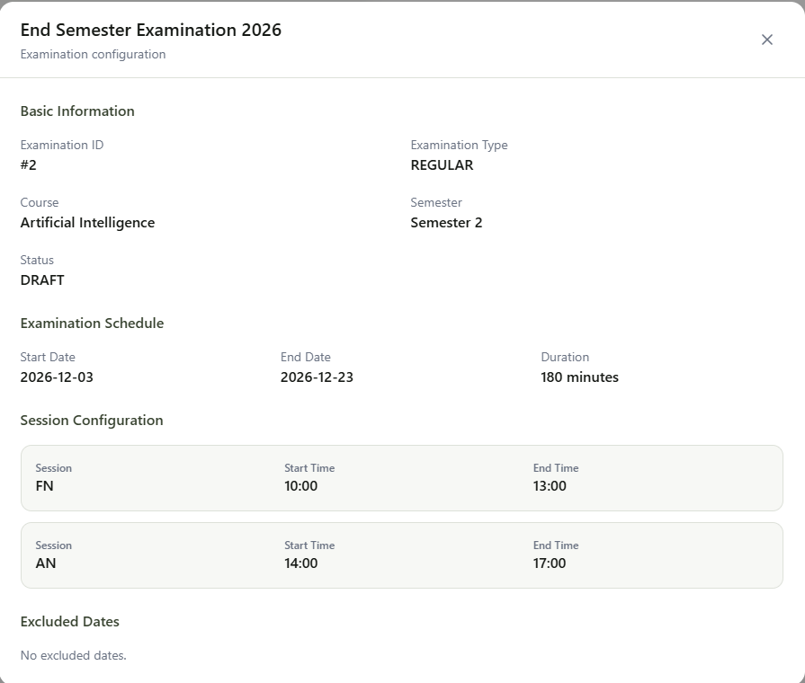
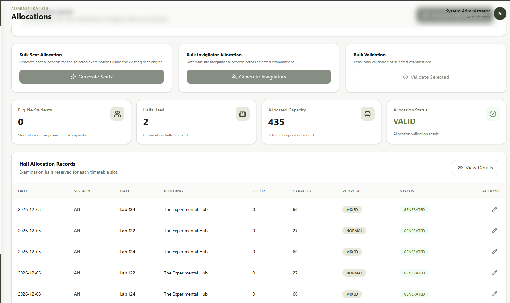
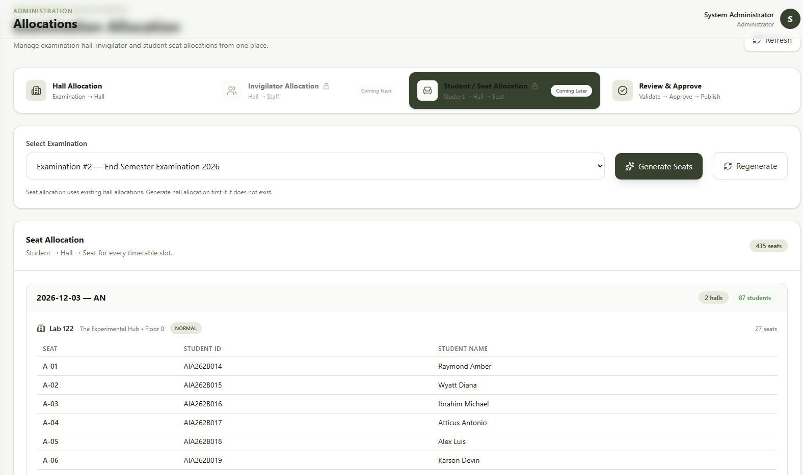
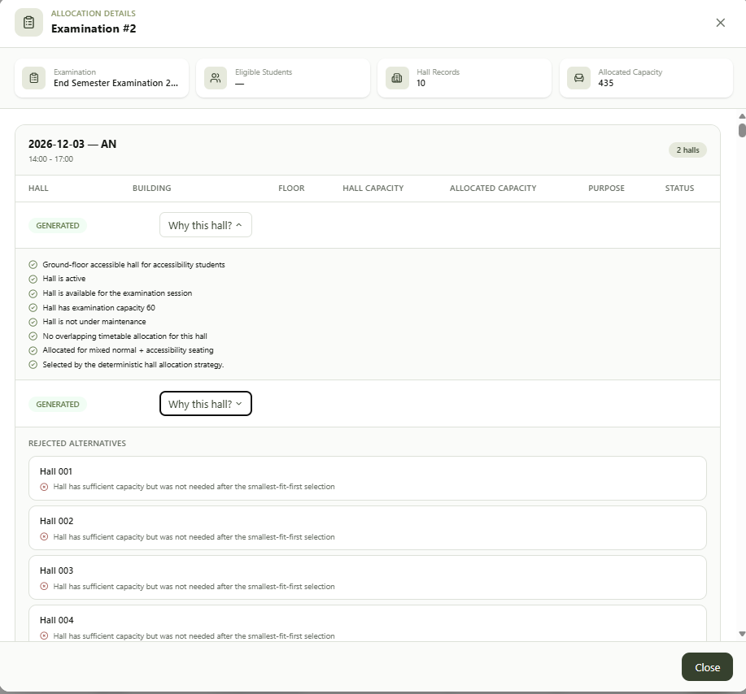
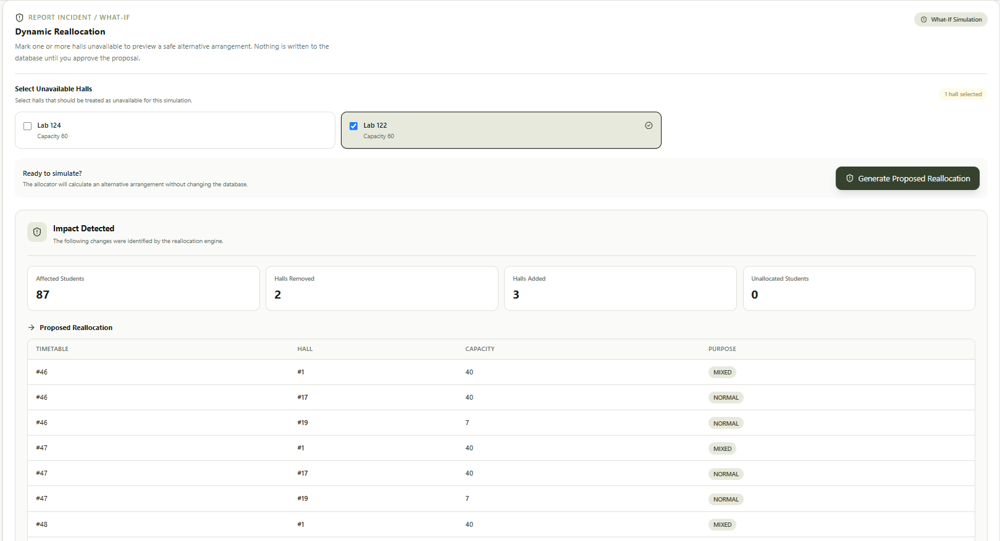
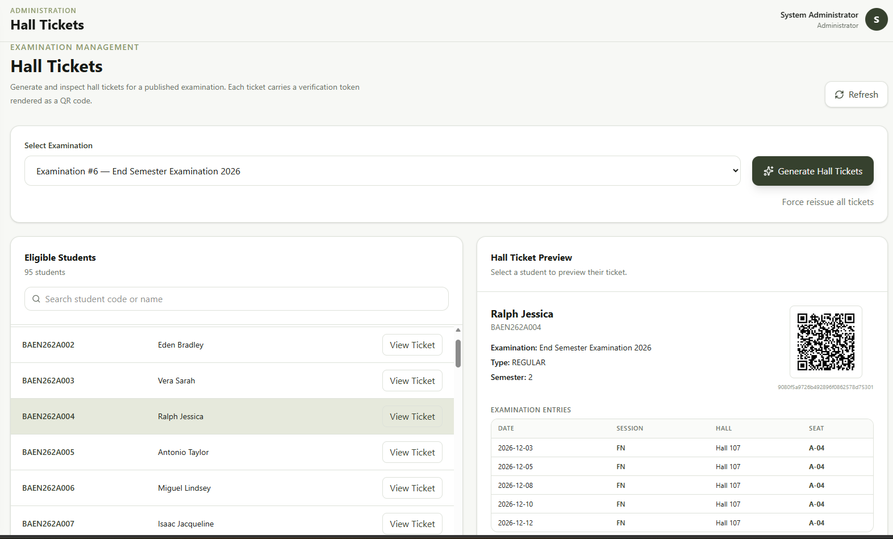
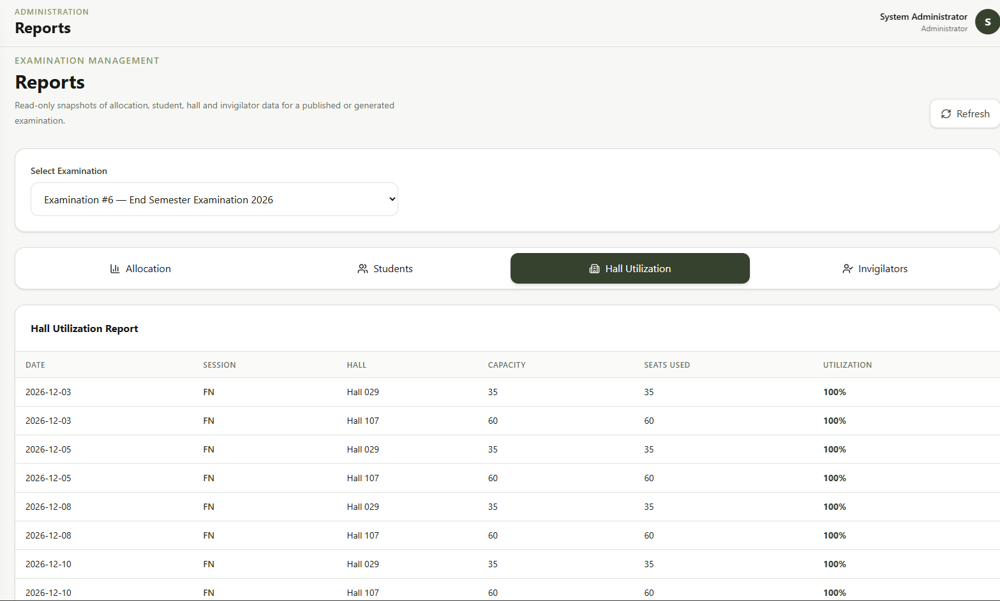

# ExamNexus — Dynamic Examination Resource Orchestration Platform

ExamNexus is a web-based examination resource orchestration platform that helps universities plan, allocate, validate, and manage examination resources.

It connects examination data, timetables, student eligibility, halls, seating, invigilators, validation, approval, hall tickets, reporting, and controlled intelligent assistance in one workflow.

## Live Demo and Project Links

- **Live Application:** [Open ExamNexus](https://examnexus-sigma.vercel.app/)
- **Source Code:** [GitHub Repository](https://github.com/mariadorthy/examnexus)
- **Demo Video:** [Watch the ExamNexus Walkthrough](https://canva.link/k26mc1ce3dyutio)
- **Project Presentation:** [ExamNexus Project Presentation](presentation/ExamNexus_Project_Presentation.pdf)

The live application depends on deployment availability and configured demo data. If the application is temporarily unavailable, use the recorded walkthrough to review the intended workflows.

## Application Walkthrough

The walkthrough demonstrates examination management, resource allocation, validation, administrator review, hall-ticket generation, QR verification, and intelligent what-if planning.

[**▶ Watch the full ExamNexus demo video**](https://canva.link/k26mc1ce3dyutio)

## Application Screenshots

The following screenshots illustrate selected workflows. They are loaded from the repository's `docs/screenshots/` directory.

### Admin Dashboard


### Examination Management



### Hall Allocation



### Seat Allocation



### Allocation Explanation and Validation



### Dynamic What-If Reallocation



### Hall-Ticket Generation



### Reports



Additional screenshots covering login, timetables, invigilator allocation, natural-language requirements, and student/staff dashboards are available in [`docs/screenshots/`](docs/screenshots/).

## Project Vision

ExamNexus supports the examination planning lifecycle, from master data and registration through resource allocation, validation, approval, publication, and reporting.

```text
Login and Role-Based Access
          ↓
Master Data Management
          ↓
Examination and Timetable
          ↓
Registration and Eligibility
          ↓
Hall Allocation
          ↓
Seat and Invigilator Allocation
          ↓
Independent Validation
          ↓
Review and Approval
          ↓
Publication and Hall Tickets
          ↓
Reports and Monitoring
```

The platform also supports controlled replanning when examination conditions change.

```text
Existing Allocation
        ↓
Resource or Constraint Change
        ↓
What-If Reallocation
        ↓
Validation
        ↓
Administrator Review and Confirmation
        ↓
Apply Changes
```

## User Roles

### Administrator

Manages examination data, timetables, registrations, resource allocations, validation, approval, hall tickets, reports, and reallocation.

### Staff / Invigilator

Accesses assigned examinations, invigilation duties, and permitted operational information.

### Student

Accesses permitted examination information, timetable, allocation details, and hall tickets.

## Core Capabilities

- Authentication and role-based access control
- Department, course, subject, student, staff, and hall management
- CSV-based data import and validation
- Examination and timetable management
- Student registration and eligibility checking
- Capacity- and constraint-aware hall allocation
- Accessibility-aware allocation
- Seat allocation and uniqueness checks
- Invigilator allocation
- Independent allocation validation
- Examination lifecycle and administrator approval
- Dynamic what-if reallocation
- Hall-ticket generation and QR-based verification
- Examination and allocation reports
- Supported read-only natural-language queries
- Explainable allocation decisions
- Natural-language understanding of supported allocation requirements

## Intelligent Assistance

ExamNexus provides controlled intelligent assistance to help administrators interpret supported requirements, query examination information, understand allocation decisions, and evaluate alternative resource arrangements.

Critical examination decisions remain governed by deterministic services, explicit constraints, validation, and administrator control.

> **AI assists understanding, querying, explanation, and adaptation; deterministic constraints, validation, optimization, and administrator approval govern critical examination decisions.**

Unsupported requirements and unsafe mutation requests are rejected rather than silently guessed or executed.

## Safety and Reliability

The system validates important examination constraints, including:

- Student eligibility and allocation completeness
- Hall capacity and availability
- Timetable and resource conflicts
- Accessibility requirements
- Seat assignment consistency
- Invigilator allocation and workload
- Reallocation proposals
- Examination lifecycle transitions

Database constraints provide an additional integrity layer, while transactional operations help maintain consistency during supported changes.

## Verification

The latest recorded local verification, dated **14 October 2026**, reported:

| Verification | Result |
|---|---|
| Backend tests | 449 passed, 6 skipped, 0 failed out of 455 collected |
| Frontend tests | 83 passed across 15 test files |
| Frontend production build | Passed, with a large JavaScript bundle advisory |
| Oxlint | Exit code 0, with warnings remaining |
| Local test database schema check | No new migration operations reported |

The six skipped backend tests depend on specific fixture-data conditions. Frontend tests use mocked API responses and do not establish live browser-to-backend integration. Local database verification does not establish the state of the deployed production database.

For detailed commands, skip reasons, audit findings, and outstanding verification gaps, see the [Project Audit and Verification Report](docs/audit/PROJECT_AUDIT_AND_VERIFICATION.md) and [Implementation and Verification Log](docs/audit/IMPLEMENTATION_AND_VERIFICATION_LOG.md).

These results document the tested scenarios; they do not establish exhaustive testing or complete production readiness.

## Technology Stack

| Layer | Technologies |
|---|---|
| Frontend | React, Vite, Tailwind CSS |
| Backend | Python, Flask |
| ORM | Flask-SQLAlchemy / SQLAlchemy |
| Database | PostgreSQL |
| Authentication | JWT-based authentication and role-based authorization |
| Testing | pytest, Vitest |
| Supporting tools | QRCode, Pillow, Flask-CORS, Flask-Migrate, dotenv |
| Development | Git and GitHub |

## Project Structure

```text
ExamNexus/
├── backend/
│   ├── app/
│   │   ├── auth/
│   │   ├── models/
│   │   ├── routes/
│   │   └── services/
│   ├── migrations/
│   ├── scripts/
│   ├── tests/
│   └── requirements.txt
├── frontend/
│   ├── public/
│   ├── src/
│   ├── package.json
│   └── vite.config.js
├── docs/
│   ├── audit/
│   └── screenshots/
├── presentation/
│   └── ExamNexus_Project_Presentation.pdf
└── README.md
```

## Documentation

Project documentation is organized under [`docs/`](docs/README.md).

- [Documentation Index](docs/README.md)
- [Project Overview](docs/project-overview.md)
- [System Architecture](docs/system-architecture.md)
- [Features and Workflows](docs/features-and-workflow.md)
- [AI and Intelligent Orchestration](docs/ai-and-intelligent-orchestration.md)
- [Development Setup](docs/development-setup.md)
- [Testing and Verification](docs/testing-and-verification.md)
- [Project Audit and Verification](docs/audit/PROJECT_AUDIT_AND_VERIFICATION.md)
- [Implementation and Verification Log](docs/audit/IMPLEMENTATION_AND_VERIFICATION_LOG.md)

The screenshots and supporting evidence are maintained in [`docs/screenshots/`](docs/screenshots/).

## Project Outcome

ExamNexus brings examination planning, resource allocation, validation, approval, reporting, and controlled reallocation into a connected workflow.

Its central capability is not merely assigning examination halls, but **coordinating interdependent resources, validating arrangements, explaining decisions, and adapting plans when constraints change** while keeping critical operations under administrator control.
